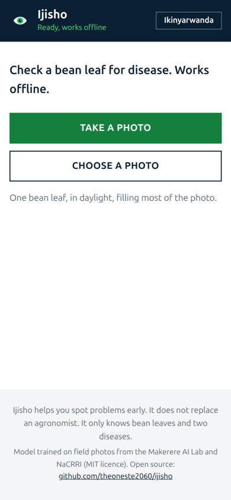
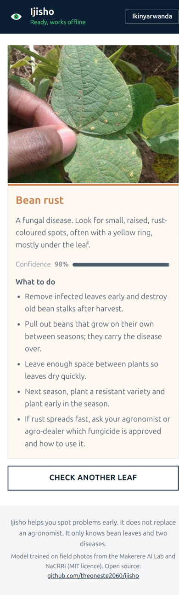

# Ijisho

**Ijisho** ("eye" in Kinyarwanda) checks a bean leaf for disease from a phone photo, **fully offline**.
A farmer or extension officer takes a photo of one leaf; Ijisho says whether it looks like
**angular leaf spot**, **bean rust**, or **healthy**, and what to do next, in **English or Kinyarwanda**.
When it isn't confident, it says so and points to a human agronomist instead of guessing.

**Try it: [ijisho-amber.vercel.app](https://ijisho-amber.vercel.app)** · open it once on a phone, then it works with no connection. On Android, use *Add to Home screen* to install it like an app.

<p>
  
  &nbsp;
  
</p>

<sub>Leaf photo from the Makerere AI Lab beans test set (MIT).</sub>

It is a *small AI* project in the World Bank's sense: a small model trained on local, relevant data, running
on the phone farmers already have, with no internet, no server and no cost per use.

## Why

Rwanda's ICT ministry has set four priorities for AI in agriculture: farmer advisory, crop and livestock
intelligence, markets and finance, and government intelligence. It has also asked builders for solutions that
"adapt to the farmer", working on basic phones, by voice and **offline**, and released as digital public goods
others can build on. Farm extension coverage is meant to grow from 35% (2023) to 69% (2029); tools like this
help each extension officer reach more farmers.

Ijisho covers one piece of *crop intelligence*: spotting two common bean diseases early. Beans are a staple
food and a key protein source across East Africa.

## How it works

| Part | What it is |
|---|---|
| Model | MobileNetV3-Small, ImageNet weights, fine-tuned for 3 classes |
| Data | [Makerere AI Lab "beans" dataset](https://huggingface.co/datasets/AI-Lab-Makerere/beans): 1,295 field photos from Ugandan farms, taken on basic smartphones, labelled by NaCRRI experts (MIT licence) |
| Runtime | [ONNX Runtime Web](https://onnxruntime.ai/) (WebAssembly) in the browser; the photo never leaves the phone |
| App | A static Progressive Web App; a service worker caches everything on first visit, then it works offline |
| Uncertainty | Below 70% confidence, Ijisho answers "not sure" and gives retake tips plus a pointer to an agronomist |

## Results

Measured on the dataset's held-out **test split (128 photos)**, which was never used for training or for
choosing the model. The validation split (133 photos) picked the best epoch.

| | Result |
|---|---|
| Test accuracy (PyTorch / ONNX, same model) | **92.2%** (118 / 128) |
| Test accuracy in the browser app | **90.6%** (116 / 128); small resize differences between the browser canvas and Python |
| When Ijisho gives an answer (confidence ≥ 70%) | right **95.4%** of the time (104 / 109) |
| Photos answered "not sure" | 19 / 128, which caught 7 of the 12 mistakes |
| Confidently wrong | 5 / 128 (3.9%) |
| Model size | 6.1 MB (full precision; an 8-bit version lost all accuracy and was rejected automatically) |
| First download, then offline | about 21 MB (model + WebAssembly runtime), cached on the phone |
| Speed | about 35 ms per photo on a laptop CPU; expect a few hundred ms on a budget phone |

Test confusion matrix (rows = true class, columns = predicted):

| | angular leaf spot | bean rust | healthy |
|---|---|---|---|
| **angular leaf spot** | 40 | 3 | 0 |
| **bean rust** | 5 | 38 | 0 |
| **healthy** | 0 | 2 | 40 |

Most mistakes are between the two diseases. No diseased leaf was called healthy on this test set.
Training takes about 8 minutes on a 4-core laptop CPU (no GPU).

## Run it

```bash
# 1. Train (CPU is fine)
python3 -m venv .venv
.venv/bin/pip install -r training/requirements.txt --extra-index-url https://download.pytorch.org/whl/cpu
# download the three parquet files from huggingface.co/datasets/AI-Lab-Makerere/beans (data/ folder) into ./data
.venv/bin/python training/train.py
.venv/bin/python training/export.py   # writes app/model/ijisho-beans.onnx

# 2. Serve the app (any static host works; the live copy runs on Vercel, see vercel.json)
cd app && python3 -m http.server 8000
```

Open http://localhost:8000 on a phone or desktop. After the first load it works with no connection.

## Limitations (read before field use)

- **It only knows bean leaves and two diseases.** A photo of another crop, another bean disease (e.g. common
  bacterial blight, anthracnose, bean common mosaic virus) or pest damage will still be forced into one of the
  three answers, though often with low confidence, which triggers "not sure".
- **The data is from Uganda.** Varieties, light and backgrounds in Rwanda may differ. Before recommending it to
  farmers, it should be tested on photos from Rwandan fields and checked with RAB agronomists.
- **The Kinyarwanda text is a first draft** and needs review by a native speaker and an agronomist.
- **The advice is general and preventive.** It never names a pesticide or dose; that is for an agronomist.
- **It is a screening aid, not a diagnosis.** It does not replace an extension officer.

## Roadmap

- Rwandan field photos and validation with agronomists
- More bean diseases, then cassava and potato
- A "send to my extension officer" button (WhatsApp/SMS) for unsure cases
- Voice output in Kinyarwanda for low-literacy users
- Android packaging for phones that can't install web apps

## Credits and licences

- Code: MIT © 2026 Theoneste NZAKIZWANIMANA ([theoneste.dev](https://theoneste-dev.vercel.app))
- Data: Makerere AI Lab with the National Crops Resources Research Institute (NaCRRI), Uganda, MIT
- Base model weights: torchvision MobileNetV3-Small (BSD-3-Clause)
- Runtime: ONNX Runtime Web © Microsoft, MIT (see `app/vendor/LICENSE`)
